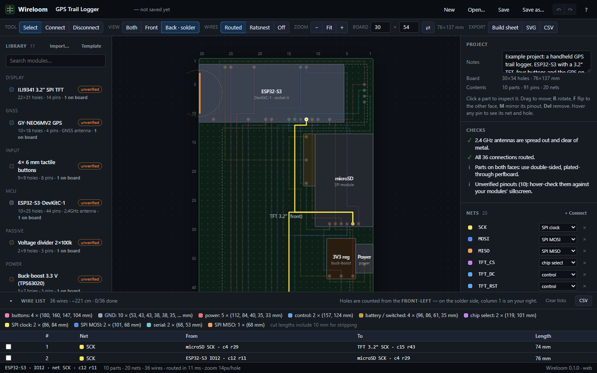

# Wireloom

**A module-level perfboard planner.** Place breakout boards — an ESP32 dev board, a GPS, a TFT,
a charger — on a hole grid, wire their pins together, and Wireloom routes every connection along the
grid and hands you a bench-ready wire list: *"ESP32 IO12 at c12 r22 → microSD SCK at c4 r39, 79 mm."*



It exists because the hard part of a perfboard build isn't the soldering — it's knowing exactly which
hole every pin lands in once a module is placed, rotated, or mounted on the *back* of the board (where
its pinout mirrors), and keeping 50-odd wires straight. Wireloom does that bookkeeping.

## What it does

- **Real pin positions.** Every module carries its header layout. Rotate it, flip it to the other face,
  and every pin moves to the right hole — back-side parts mirror automatically.
- **Routes the wires.** A grid router lays each connection hole-to-hole, preferring straight runs and
  avoiding other pins, wires, module bodies and antenna zones. ~15 ms for the 36-wire example.
- **Two-sided boards.** Views for *Both* (x-ray), *Front*, and *Back · solder* — the solder side drawn
  **mirrored**, exactly as you'll see it flipped over.
- **RF-aware checks.** 2.4 GHz antennas too close together, metal (a screen, a battery) in an antenna's
  keep-out, two pins in one hole, parts that don't fit, unrouted connections.
- **Bench outputs.** A tick-off wire list with hole numbers and lengths, a per-colour cut list, CSV, SVG
  drawings, and a one-page printable **build sheet** (drawings + checks + BOM + cut list + wire list).
- **Your own modules.** A module is a small JSON file; start from the in-app template and import it.
- **Desktop app with automatic updates** (Windows), or run it in any Chromium browser.

## Install (Windows)

Download **`Wireloom-Setup-<version>.exe`** from the
[Releases page](https://github.com/otarZAP/wireloom-showcase/releases) and run it. It installs per-user (no admin
rights), adds Start-menu and desktop shortcuts, and opens `.wireloom` files on double-click.

> **"Windows protected your PC"** — the installer isn't code-signed yet, so SmartScreen warns about an
> unknown publisher. Click **More info → Run anyway**. (Signing options are in
> [docs/RELEASING.md](docs/RELEASING.md).)

Wireloom checks for updates a few seconds after it starts; a new version downloads in the background,
and the status bar offers *"Update ready — click to restart"*.

## Using it

1. **Place parts** — open a module in the **Library** (left) and *Add to front* or *Add to back*. Drag
   to move; **R** rotate, **F** flip to the other face, **M** mirror the pinout, **Del** remove.
2. **Wire pins** — pick **Connect** (**C**), click a pin, then the pin to wire it to. Shift-click keeps
   chaining from the last pin. **Disconnect** (**X**) takes a pin back out of its net.
3. **Check** — the **Checks** panel (right) flags antenna spacing, metal near antennas, pin collisions.
   Hover any pin for its name, net and hole.
4. **Build** — the **wire list** (bottom) is your checklist; tick wires off as you solder. **Build
   sheet** exports everything as one printable page.

Holes are numbered **from the front-left corner** (column · row). On the solder side, column 1 is on
your **right** — mark "FRONT TOP" and "C1" on the board before you start. Press **?** in the app for every
shortcut.

The bundled example is a **handheld GPS trail logger**: a 3.2" TFT, four buttons and the GPS on the
front; an ESP32-S3-DevKitC-1 lying sideways on the back so its antenna clears the screen; microSD for the
logs; and a LiPo → TP4056 → switch → buck-boost power chain. It routes all 36 connections with every check
clean — open it from *File → Open the example project*.

> **Pinouts marked *unverified*** are modelled from common modules, not measured from yours. Hover each
> pin and compare it with your module's silkscreen before soldering; if a module's pinout is reversed,
> select it and press **Mirror pinout**.

## Your own modules

**Library → Template** downloads a starting `.module.json`. Fill in its size and pin holes (0.1" grid,
parts side up, counted from the top-left), then **Library → Import…**. Imported modules are kept on
this machine, and every project embeds copies of the modules it uses, so a `.wireloom` file always opens
the same way. The formats are documented in [docs/FORMATS.md](docs/FORMATS.md).

## Develop

Needs Node 20+ (developed on 24) and, for the browser tests, Microsoft Edge or Chrome.

```sh
npm install
npm run dev          # live-reloading web build at http://localhost:5173
npm test             # core tests (geometry, nets, router, checks, formats) — no browser
npm run test:e2e     # drives the built app in headless Edge (run `npm run build` first)
npm run test:all     # both
npm run app          # build + run the desktop app
npm run dist         # build the Windows installer into release/
```

`npm run app` strips `ELECTRON_RUN_AS_NODE`, which VS Code sets in its terminals and which otherwise
stops Electron from starting.

```
src/core/      pure logic, no DOM: geometry, project format, netlist, router, checks, SVG, build sheet
src/ui/        the editor: state + undo, board interaction, panels, commands, dialogs
electron/      desktop shell: native files, menu, unsaved-changes guard, auto-update
library/       built-in module definitions (*.module.json)
examples/      an example project (a GPS trail logger)
test/          core tests (node:test) and e2e/ browser tests (puppeteer-core + Edge)
tools/         icon renderer, Electron launcher
docs/          file formats, releasing
```

## Releasing

See [docs/RELEASING.md](docs/RELEASING.md): bump the version, push a `v*` tag, and GitHub Actions builds
the installer and publishes it as a release — which is also the auto-update feed.

## Roadmap

- **Module editor** — draw a footprint and click pins into place, instead of editing JSON.
- **Import** — pin positions from Fritzing parts and KiCad footprints; nets from a KiCad netlist.
- **Router** — rip-up-and-reroute for dense boards, lockable hand-drawn wires, and a stripboard mode
  with track cuts.
- **More library** — Arduino Nano/Pro Mini, ESP32-C3/C6 boards, SX1262/Heltec LoRa, OLEDs, MOSFET and
  level-shifter modules — each marked verified once checked against real hardware.
- **Bench mode** — step through the wire list one wire at a time, with that wire highlighted.
- macOS/Linux builds (the code is cross-platform; only the release workflow is Windows-only today).

## Licence

[MIT](LICENSE) — free to use, modify and share, including in your own projects. Module definitions you
add to the library are welcome as pull requests, especially ones you've verified against real hardware.
